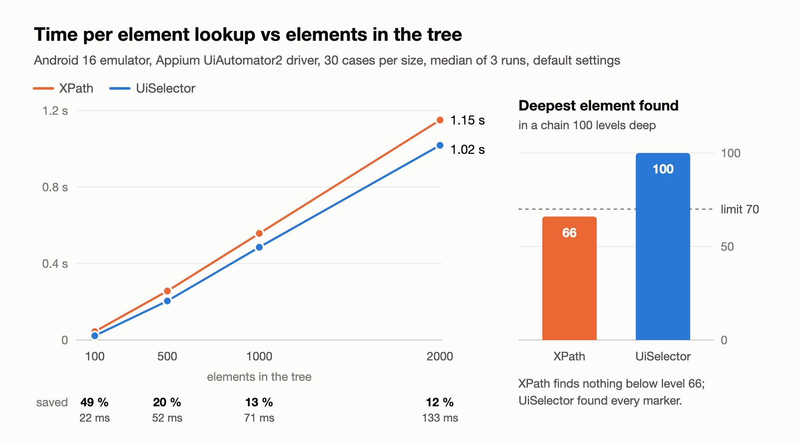
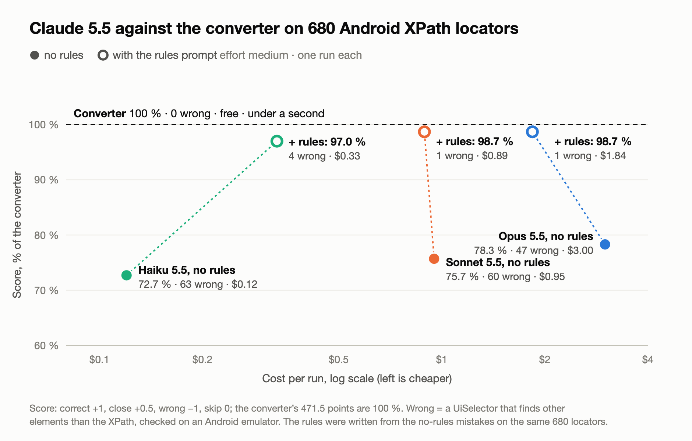
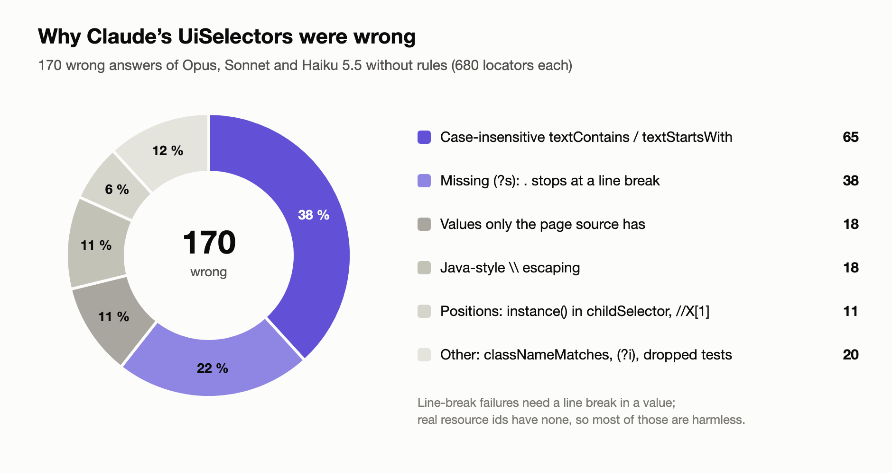

<!--
Images: dev.to does not take relative paths. Upload the PNGs from docs/articles/img/
in the editor (or use their raw GitHub URLs) and replace the paths below.
All numbers come from docs/results.md, audit/coverage-report.md, audit/llm/report.md
and the benchmark's REPORT.md (github.com/domovou69/appium-android-locator-benchmark).
-->

## TL;DR

- **UiSelector is faster than XPath on Android:** it won all 30 benchmark cases. It saved 49 % per lookup at 100 elements and 12 % at 2000 (emulator). Below level 70 of the tree, XPath finds nothing at all.
- **73 % of 1645 real XPath locators convert** to a `UiSelector`. Every converted one ran on an emulator with **0 wrong** results; the rest are skipped with a reason.
- **Claude 5.5 without rules: 47–63 wrong UiSelectors out of 680** (7–9 %). They look right and often pass a quick check. With a rules prompt, Opus and Sonnet made 1 and Haiku 4, and still no model beat the converter.

```bash
npx xpath-to-uiselector ./tests          # preview the diff
npx xpath-to-uiselector ./tests --write  # apply it
```

Or paste a single XPath into the [online converter](https://domovou69.github.io/xpath-to-uiselector/).

---

**Contents**

1. [Why leave XPath on Android](#why-leave-xpath-on-android)
2. [What a UiSelector is](#what-a-uiselector-is)
3. [Why converting by hand goes wrong](#why-converting-by-hand-goes-wrong)
4. [What the converter does](#what-the-converter-does)
5. [How I checked it](#how-i-checked-it)
6. [Claude 5.5 against the converter](#claude-55-against-the-converter)
7. [Android is harder than iOS](#android-is-harder-than-ios)
8. [The future of UiSelector](#the-future-of-uiselector)
9. [What I would use](#what-i-would-use)
10. [Limits](#limits)

---

This is the Android follow-up to my iOS posts. In [part 1](https://dev.to/mikhail_yesipchuk/xpath-to-ios-class-chain-a-converter-you-can-trust-and-when-it-is-actually-faster-c6o) I built a converter from XPath to iOS class chain; in [part 2](https://dev.to/mikhail_yesipchuk/xpath-to-ios-class-chain-can-claude-do-it-instead-of-a-converter-17m9) I asked Claude to do the same job. On iOS the best model came within a few points of the converter.

On Android I did both in one go: I built [xpath-to-uiselector](https://github.com/domovou69/xpath-to-uiselector), then asked Claude Opus, Sonnet and Haiku 5.5 to convert the same locators. Android turned out to be much harder for the models, and the reason is in the API, not in the models.

## Why leave XPath on Android

With the Appium UiAutomator2 driver, an XPath lookup first serializes the whole UI tree to XML and then runs the query on it. A `UiSelector` (the `-android uiautomator` strategy) walks the live tree and stops at the first match. I measured both in a [separate benchmark](https://github.com/domovou69/appium-android-locator-benchmark): 30 cases (10 XPath shapes × 3 targets), each found by both strategies, on screens of 100 to 2000 elements.



- **UiSelector won all 30 cases at every size.** The saving in milliseconds grows with the tree (22 ms → 133 ms), the saving in percent shrinks (49 % → 12 %).
- **The depth limit matters more than the speed.** The driver's `snapshotMaxDepth` is 70: below that, XPath and the page source see nothing. On a chain 100 levels deep, XPath found its last marker at level 66, and `UiSelector` found every marker down to level 100.
- **It is not 10–50× faster.** Blog posts often say that, without showing a measurement. I measured 12–49 %: worth having on big screens and in long suites, but not a miracle.

## What a UiSelector is

`UiSelector` is the androidx UiAutomator query builder. Appium takes it as a Java-like string and evaluates it on the device:

| XPath | UiSelector |
| --- | --- |
| `//android.widget.Button` | `new UiSelector().className("android.widget.Button")` |
| `//*[@text="Pay"]` | `new UiSelector().text("Pay")` |
| `//*[@content-desc="Cart"]` | `new UiSelector().description("Cart")` |
| `//*[@resource-id="com.app:id/ok"]` | `new UiSelector().resourceId("com.app:id/ok")` |
| `//*[@checked="true"]` | `new UiSelector().checked(true)` |
| `(//android.widget.EditText)[2]` | `new UiSelector().className("android.widget.EditText").instance(1)` |

It has no direct-child or parent step and no position among siblings: `childSelector` means any descendant, and `fromParent` searches among the siblings.

## Why converting by hand goes wrong

The simple rows above are what everyone converts correctly. The trouble is the methods whose names promise the same thing as XPath but behave differently. All of these were checked on the emulator:

| XPath | Looks right | Why it is wrong |
| --- | --- | --- |
| `contains(@text,"Total")` | `textContains("Total")` | `textContains` and `textStartsWith` **ignore case**: this also finds "TOTAL". Exact: `textMatches("(?s).*Total.*")` |
| `matches(@resource-id,".*\.ok")` | `resourceIdMatches(".*\\.ok")` in the locator text | The server's string literal unescapes only `\"`, so the regex gets `\\.`, a literal backslash. It matches nothing |
| `(//ScrollView//ImageView)[3]` | `…childSelector(…ImageView.instance(2))` | Inside `childSelector`, `instance()` counts per container, not across the screen |
| `//*` | `classNameMatches(".*")` | With `classNameMatches`, `findElements` iterates `index(i)` and loses elements |
| `//ListView/TextView` | `…childSelector(…)` | That is any descendant. UiSelector has no direct child, so there is no exact form |
| `ends-with(@text,"USD")` | "skip: XPath 2.0" | The driver runs XPath 2.0 unless `enforceXPath1` is set. `matches()`, `ends-with()`, `lower-case()` all work |

None of these fails loudly. The first one is the dangerous kind: the test passes today and taps the wrong element when someone adds a "TOTAL" label.

## What the converter does

[xpath-to-uiselector](https://github.com/domovou69/xpath-to-uiselector) scans your test files (Java, Kotlin, Python, JS/TS, C#, Ruby, JSON, YAML), finds the XPath strings and rewrites each one together with its strategy call:

```diff
- AppiumBy.xpath("(//android.widget.TextView[@content-desc='price'])[2]")
+ AppiumBy.androidUIAutomator("new UiSelector().className(\"android.widget.TextView\").description(\"price\").instance(1)")

- (AppiumBy.XPATH, '//*[@content-desc="Cart" and contains(@text, "USD")]')
+ (AppiumBy.ANDROID_UIAUTOMATOR, 'new UiSelector().description("Cart").textMatches("(?s).*USD.*")')

[skip] UiSelector has no direct-child criterion: //android.widget.ListView/android.widget.TextView[1]
```

Every XPath ends up in one of three groups:

- **Exact:** the `UiSelector` finds the same elements in the same order.
- **Close:** the same first element, but not always the same list, for example `//A//B` → `childSelector`. It comes with a warning, and `--exact` leaves these alone.
- **Skip:** there is no exact `UiSelector`. Most skips come with a hint on how to rewrite the locator by hand.

The bare command only previews. `--write` saves, `--json` writes a report with every skip and warning. Node.js 20+, no dependencies. To try a single XPath without installing anything, use the [online converter](https://domovou69.github.io/xpath-to-uiselector/): it runs the same code in the browser.

## How I checked it

The order was facts first, the converter last:

1. **The source code:** the UiAutomator2 server, androidx `UiSelector` and the XPath engine the driver uses, at pinned versions. That is where the case-insensitive `Contains` and the `\"`-only unescaping came from.
2. **162 edge cases**, each with a hand-written expected answer, **ran on an Android emulator before the converter existed**: XPath and `UiSelector` side by side, comparing the elements they find. Where the device disagreed with me, the case was corrected.
3. **1645 real XPath locators from 20 open-source Appium projects.** Every converted one (1169 distinct XPaths) ran on random screens built from its own values and on screens built to break each condition. **0 wrong.**
4. **Checking the check:** 1718 deliberately wrong `UiSelector`s; the screens caught 99.5 % of them.

Android 16 emulator (and Android 17 for the edge cases), Appium 3.8.0, UiAutomator2 driver 8.7.0, default driver settings. The result: **73 % convert (64 % exact, 9 % close)**. Most of the rest have no exact `UiSelector` at all: direct children, absolute `/hierarchy/…` paths, sibling positions, web and iOS attributes.

## Claude 5.5 against the converter

I used the same setup as in the [iOS comparison](https://dev.to/mikhail_yesipchuk/xpath-to-ios-class-chain-can-claude-do-it-instead-of-a-converter-17m9):

- **680 XPaths:** 149 edge cases and 531 real locators from 19 projects, shuffled, with neutral ids.
- **One request per run:** "convert each one to a UiSelector, or skip it with a reason". Claude Code CLI in an empty folder, Read and Write tools only, effort `medium`, one run per model.
- **The judge:** every answer that differs from the converter's ran on the emulator next to the XPath.

**Scoring:** a correct `UiSelector` earns 1 point, a close one 0.5, a skip 0, and a **wrong one −1**: it is worse than a skip, because it looks like a valid locator and finds another element. The converter's 471.5 points are 100 %.



| Run | Correct | Close | Wrong | Skip | Missed | Score | Min | Cost |
| --- | --- | --- | --- | --- | --- | --- | --- | --- |
| **Converter** | 452 | 39 | **0** | 189 | – | **100 %** | < 0.1 | free |
| Opus 5.5 | 400 | 32 | 47 | 179 | 22 | 78.3 % | 12.2 | $3.00 |
| Sonnet 5.5 | 401 | 32 | 60 | 176 | 11 | 75.7 % | 4.9 | $0.95 |
| Haiku 5.5 | 390 | 32 | 63 | 169 | 26 | 72.7 % | 5.2 | $0.12 |

"Missed" means the model skipped a locator that the converter converts correctly. Cost is the API list price the CLI reports.

- **Every model got most of the list right.** Around 400 correct answers each; the easy locators are easy for everyone.
- **But 7–9 % of the answers were wrong**, and they look exactly like the correct ones.
- **Opus thought longest and was still wrong 47 times.** Most of its 22 missed locators came from assuming that the driver runs XPath 1.0.

### What the models get wrong



More than a third of all wrong answers are one trap: `textContains` for `contains()`. Every model fell into it 20–23 times. The next group is a regex without `(?s)`, where `.` stops at a line break; real resource ids have no line breaks, so those are mostly harmless. Then come the Java-style `\\` (Sonnet alone: 15), values that exist only in the page source (an empty text, a toast, a slider's value), and positions inside `childSelector`.



| Mistake | Opus | Sonnet | Haiku |
| --- | --- | --- | --- |
| Case-insensitive `textContains` / `descriptionContains` / `textStartsWith` | 20 | 23 | 22 |
| Missing `(?s)` in a regex | 14 | 8 | 16 |
| Java-style `\\` in a regex or value | 1 | 15 | 2 |
| Values only the page source has (`@text=""`, a toast, a range widget's value) | 0 | 9 | 9 |
| Positions: `instance()` in `childSelector`, `//X[1]` | 8 | 0 | 3 |
| `classNameMatches`, `(?i)` for `translate()`, dropped existence tests, criteria UiSelector does not have | 4 | 5 | 11 |
| **Wrong** | **47** | **60** | **63** |

Each wrong answer is counted once, under the first mistake it shows.



### A prompt with rules

As on iOS, most of these mistakes are about knowing the driver, not about intelligence. So I wrote them down as general rules (8 k characters, [`rules.md`](https://github.com/domovou69/xpath-to-uiselector/blob/main/audit/llm/rules.md), no answers for particular locators) and ran the three models again:

| Run | Correct | Close | Wrong | Skip | Missed | Score | Min | Cost |
| --- | --- | --- | --- | --- | --- | --- | --- | --- |
| **Converter** | 452 | 39 | **0** | 189 | – | **100 %** | < 0.1 | free |
| Opus 5.5 + rules | 448 | 37 | 1 | 189 | 5 | 98.7 % | 5.9 | $1.84 |
| Sonnet 5.5 + rules | 448 | 37 | 1 | 189 | 5 | 98.7 % | 4.1 | $0.89 |
| Haiku 5.5 + rules | 443 | 37 | 4 | 189 | 7 | 97.0 % | 6.3 | $0.33 |

- **Wrong answers dropped from 47–63 to 1–4.** The one left for Opus and Sonnet is a line-break case: `string-length(@text)=5` → `textMatches("(?s).{5}")`, where ICU's `.` takes CR LF as one character. Haiku also dropped the `className` three times, against an explicit rule.
- **Opus got cheaper and faster with the rules:** half the time, 60 % of the cost, a quarter of the thinking.
- **This is an upper bound.** The rules were written from the mistakes on the same 680 locators, and every run was done once.

### What the models gave back

The comparison also tested the converter. The first Opus run found **one real converter bug**: `contains(@text,"1.5")` was marked exact, but a slider at 1.5 has that text only in the page source, so the XPath finds the slider and the `UiSelector` does not. It is now a close match with a warning. Across the six runs, the models also found **8 locators the converter skipped although an exact `UiSelector` exists** (`normalize-space()`, `string-length()`, `translate()`, `if … then … else`, and a few more). I checked each one on the emulator and added all 8 to the converter. After that, no model beats the converter on any locator.

## Android is harder than iOS

On iOS, the same three Claude 5.5 models with a plain request made **4–7 wrong class chains out of 676**. On Android they made **47–63 out of 680**, roughly ten times as many.

My explanation: a class chain filter is an NSPredicate, a language the models know well, and its `CONTAINS` is case-sensitive unless you add `[c]`, just like XPath. `UiSelector` reuses XPath-like names with different meanings: `textContains` ignores case, the string literal is not Java, `instance` inside `childSelector` counts per container. Those are exactly the mistakes in the chart above. A model that "knows" UiSelector from Java code samples has seen these methods used, but rarely with the details that make them differ from XPath.

The two runs are not identical (iOS ran at `low` and `medium` effort, Android at `medium`; the locators are different), so take the ratio as a direction, not a measurement.

## The future of UiSelector

Google plans to [deprecate and remove](https://developer.android.com/training/testing/other-components/ui-automator-legacy#ui-automator) `UiSelector` from UiAutomator, and the UiAutomator2 driver warns that every `-android uiautomator` locator will then stop working. No date or version is set: UiAutomator 2.4.0 (July 2026) still ships it, and the driver's server bundles 2.3.0. Appium has not announced a replacement yet ([appium-uiautomator2-driver#812](https://github.com/appium/appium-uiautomator2-driver/issues/812) is open).

So converting today is a bet on a few more years of speed, not forever. XPath locators are not affected, and the converter only rewrites strings, so going back is a `git revert`. The repository has a monthly job that opens an issue when the driver changes a file the conversion rules depend on.

## What I would use

1. **The converter first.** It is free, offline, takes under a second for 680 locators, gives the same answer every time and made no wrong `UiSelector`.
2. **A model only for what the converter skips**, with [the rules](https://github.com/domovou69/xpath-to-uiselector/blob/main/audit/llm/rules.md) in the prompt. Sonnet 5.5 at `medium` was as good as Opus for half the cost. Most skips have no exact `UiSelector` at all, so expect an explanation rather than a conversion.
3. **Never paste a model's `UiSelector` into a test without running it** on the screen it is meant for. Without the rules, about one in twelve was wrong, and none of them looked wrong.
4. **Run `--exact` first** if you want only conversions with no caveats, then review the close ones.

If you use Claude Code, the repository has a [skill](https://github.com/domovou69/xpath-to-uiselector/tree/main/.claude/skills/xpath-to-uiselector) that does exactly that: it runs the converter, then reviews each skipped locator and suggests a rewrite, marked as unverified.

## Limits

- **Emulator only.** Android 16 and 17, AOSP and Google Play images on an M1 Pro. No real phone, no older Android versions, no OEM builds.
- **Default driver settings only.** `enforceXPath1`, `allowInvisibleElements` and similar settings change the answers.
- **Speed was measured on one synthetic View-based app.** Compose and WebView screens were not measured.
- **One run per model.** Two runs with the same rules gave Haiku different mistakes.
- **The rules were fitted on the same 680 locators** they are scored on.
- **Only Claude models.** Other LLMs were not tested.

## Try it

- Online converter: [domovou69.github.io/xpath-to-uiselector](https://domovou69.github.io/xpath-to-uiselector/)
- `npx xpath-to-uiselector ./tests` ([npm](https://www.npmjs.com/package/xpath-to-uiselector), [GitHub](https://github.com/domovou69/xpath-to-uiselector))
- The full LLM report: [`audit/llm/report.md`](https://github.com/domovou69/xpath-to-uiselector/blob/main/audit/llm/report.md)
- iOS counterpart: [xpath-to-class-chain](https://github.com/domovou69/xpath-to-class-chain)

## Acknowledgements

Thanks to Anthropic: [Claude Code](https://claude.com/claude-code) helped me build the converter, the checks and the comparison, and the Claude models are also the subject of the test. All numbers come from real runs.

---

_[Mikhail Yesipchuk](https://www.linkedin.com/in/mikhail-yesipchuk/), SDET/Senior QA Automation Engineer. Have you moved Android locators off XPath, and what broke? Tell me on [LinkedIn](https://www.linkedin.com/in/mikhail-yesipchuk/) or open an issue on [GitHub](https://github.com/domovou69/xpath-to-uiselector/issues)._
