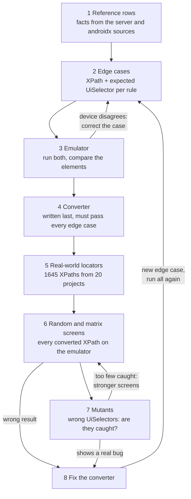
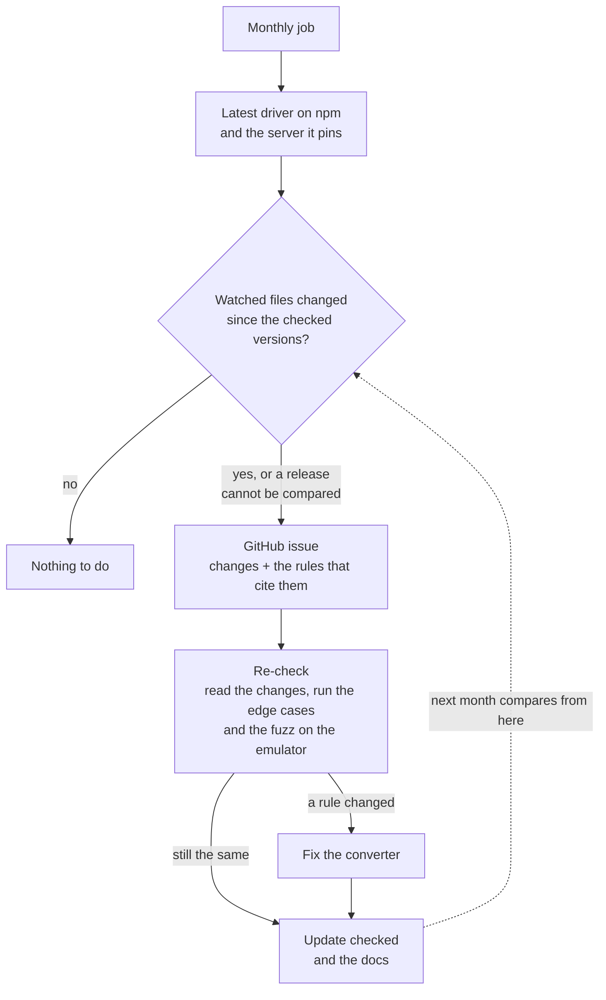

# How it works

Three pictures: what the converter does with your files, how its rules were built and checked, and how the project
notices when a new Appium driver changes something the rules depend on. The terms used in the audit files are
listed at the end.

## 1. What the converter does

```mermaid
flowchart TD
  files["Your test files<br/>Java, Kotlin, Python, JS/TS, C#, Ruby, data files"] --> find["Find quoted strings<br/>that look like an XPath"]
  find --> parse["Parse the XPath"]
  parse --> rules{"Conversion rules"}
  rules -->|exact| exact["UiSelector"]
  rules -->|close| close["UiSelector + warning"]
  rules -->|skip| skip["Leave the XPath<br/>report the reason"]
  exact --> call{"XPath strategy call<br/>around the string?"}
  close --> call
  call -->|"yes, or a JS/TS string"| write["Rewrite the string and the call<br/>preview, or save with --write"]
  call -->|no| report["Leave the file<br/>report the UiSelector to use"]
```

- **Exact:** the `UiSelector` finds the same elements in the same order as the XPath.
- **Close:** the same first element, but not always the same list (for example `//A//B` → `childSelector`); the
  warning says how it differs.
- **Skip:** no exact `UiSelector` exists, such as a direct child `//A/B` or a sibling position `//X[2]`.
- The string and its strategy call change together (`AppiumBy.xpath` → `AppiumBy.androidUIAutomator`), because a
  `UiSelector` passed to an XPath strategy fails at runtime. A JS/TS string with no call becomes
  `android=new UiSelector()…` (WebdriverIO). Anything else is only reported.

Every rule: [reference.md](reference.md).

## 2. How it was built and checked

The order was: facts first, expected answers proven on a device second, the converter last. Then real locators and
deliberately wrong answers tested the checks themselves.



1. **Reference rows** ([reference/](../reference/README.md)): what the UiAutomator2 server, androidx `UiSelector` and
   the XPath engine actually do, with the source file and line at pinned versions.
2. **Edge cases** ([audit/spec/cases.js](../audit/spec/cases.js)): at least one XPath per reference row, with its
   class (exact, close, skip) and a hand-written expected `UiSelector`. 170 cases, 6 of them for loose mode.
3. **Emulator** ([audit/device/](../audit/device/README.md)): every edge case ran on an Android emulator before the
   converter existed; `findElements` by XPath and by `UiSelector`, the two element lists compared. Where the device
   disagreed, the case was corrected (for example, `//*` turned out exact).
4. **Converter**: written last, against the edge cases (`npm run spec:score` fails on any wrong answer).
5. **Real-world locators** ([audit/corpus/](../audit/corpus/sources.md)): XPath literals from 20 open-source
   Appium projects, converted offline.
6. **Screens**: every converted XPath ran on random screens built from its own values, then on a matrix screen that
   breaks each condition in every way that applies.
7. **Mutants**: deliberately wrong `UiSelector`s, the kind of mistake a converter makes. The random screens caught
   only 62 % of them, so the matrix screens were added: 99.5 % caught. A surviving mutant also exposed a real bug
   (`textMatches` crosses line breaks), which became edge case H11.
8. **Fix**: a fix comes with a new edge case, and everything runs again.

Results: [results.md](results.md). Method and limits: [coverage report](../audit/coverage-report.md).

## 3. Monthly upstream watch

The rules are exact for one driver and server version. A scheduled job notices when a new release changes a file
the rules cite. No LLM is involved: any change to a watched file opens an issue.



`checked` is a field in [audit/upstream.json](../audit/upstream.json). The same job also follows tracked upstream
issues, such as [appium-uiautomator2-driver#812](https://github.com/appium/appium-uiautomator2-driver/issues/812)
on the removal of `UiSelector`: each run logs their status and what you need to do, and a new comment or a state
change opens an issue. Details: [audit/upstream/](../audit/upstream/README.md).

## Terms

The audit scripts and the summaries they generate use short labels. In the docs they have plain names:

| Label in generated files | Plain name | Meaning |
| --- | --- | --- |
| S | edge cases | XPaths written from the reference rows, each with its expected answer ([cases.js](../audit/spec/cases.js)) |
| R | real-world locators | XPath literals from 20 open-source projects; also the score over them |
| C | conversion rate | converted / all Android XPath literals of the real-world locators |
| CORRECT | correct | exact: the expected `UiSelector`; close: the expected one with its warning; on the device: the same elements in the same order |
| CORRECT-SKIP | correctly skipped | skipped where the edge case expects a skip |
| DRIFT | close match | a close form whose first element agrees with the XPath's; counts 0.5 in a score |
| WRONG | wrong | a conversion that finds other elements, or one that should have been skipped |
| GAP | missed | skipped where an exact or close conversion was expected |
| VACUOUS | nothing matched | neither locator found anything on the item's own screen, so the run proves nothing |
| CONFIRMED | confirmed | an edge case whose expected `UiSelector` matched the XPath on every device screen |
| DIFFERS | differs as warned | a close form that returned a different list, in the way its warning says |
| xpath only | xpath only | a skip case on the device: there is no `UiSelector` to compare, so only the XPath runs |
| mutant | mutant | a deliberately wrong `UiSelector`; "killed" means the check caught it |

Scores: edge cases = 100 × (correct + correctly skipped + 0.5 × close match) / cases; real-world =
100 × (correct + 0.5 × close match) / converted XPaths. A close form scores 0.5 even when it always agrees.
